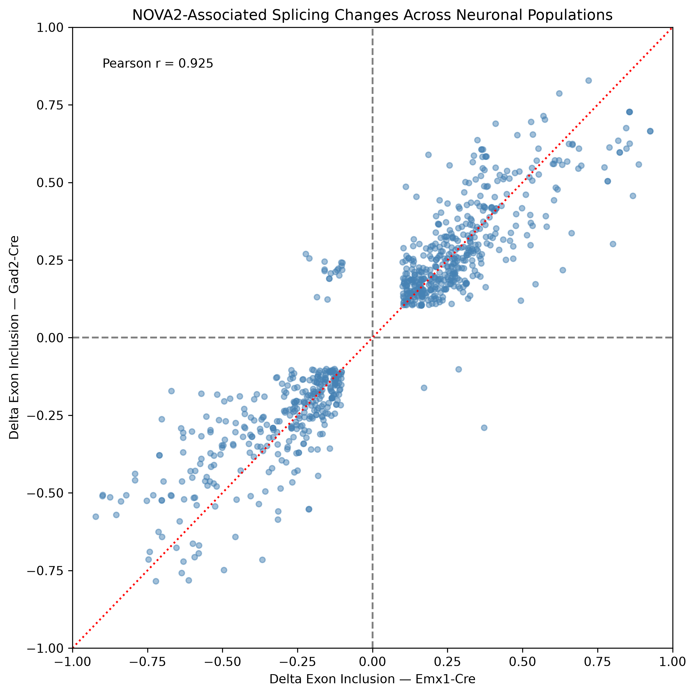
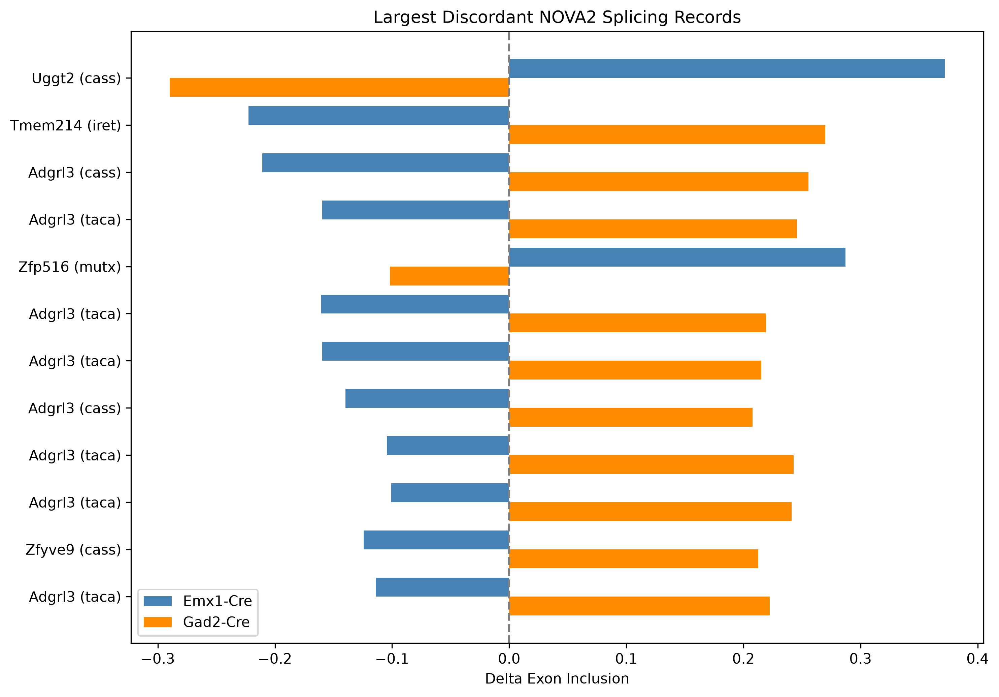

# rna-seq-expression-analysis
Python-based analysis and visualization of public RNA-seq data, including quality control, PCA, and differential gene expression.
NOVA2-Associated Alternative Splicing Across Neuronal Populations

**Overview**

This project investigates alternative RNA splicing associated with NOVA2 loss in two mouse neuronal populations using publicly available RNA-seq analysis results.

The primary objective is to determine how consistently NOVA2-associated splicing changes occur across Emx1-Cre and Gad2-Cre neuronal populations and identify candidate events with divergent responses.

The analysis uses Python to process splicing-event data, compare gene-level overlap, match alternative-splicing events across datasets, quantify concordance, and investigate individual genes of interest.

**Biological Background**

NOVA2 is an RNA-binding protein involved in regulating alternative splicing in neurons. Alternative splicing enables a single gene to produce multiple RNA isoforms and plays an important role in neuronal development and function.

Understanding whether NOVA2 regulates shared or population-specific splicing programs can provide insight into how RNA processing contributes to neuronal diversity.

Dataset

Source: NCBI Gene Expression Omnibus, GSE103314

Experimental comparisons:

Emx1-Cre control vs. Nova2 conditional knockout

Gad2-Cre control vs. Nova2 conditional knockout

Genome assembly: Mouse mm10

The project uses processed alternative-splicing results generated with Quantas. The supplied files were prefiltered for statistical significance and exon inclusion changes, so they do not represent all measured splicing events.

**Analysis Workflow**

Data processing: Imported and cleaned alternative-splicing results using pandas.

Exploratory analysis: Examined splicing-event distributions, inclusion changes, and statistical significance.

Gene-level comparison: Identified genes represented in both neuronal populations and those present in only one filtered dataset.

Event matching: Matched splicing events using gene symbols, event identifiers, and splicing types. Excluded ambiguous duplicate identifiers from the primary comparison.

Cross-population analysis: Calculated Pearson correlation and directional agreement for matched events.

Candidate investigation: Examined discordant events and their genomic annotations, focusing on Adgrl3.

**Key Findings**

1. Gene-level overlap

Emx1-Cre: 1,044 genes with reported splicing events

Gad2-Cre: 880 genes

Shared: 427 genes

Emx1-only: 617 genes

Gad2-only: 453 genes

These findings indicate that the two filtered datasets share a substantial set of genes while also containing many nonoverlapping genes.

2. Strong agreement across matched splicing events

After excluding ambiguous duplicate identifiers, 815 events were matched between the two neuronal populations.

Metric

Result

Matched events

815

Pearson correlation

0.925

Same-direction changes

794 (97.4%)

Opposite-direction changes

21 (2.6%)

The high correlation suggests that the magnitude and direction of exon inclusion changes are strongly conserved among events represented in both filtered datasets.

### Splicing concordance between neuronal populations



3. Candidate divergent splicing events

Among the 21 opposite-direction records, nine were associated with Adgrl3, a gene involved in neuronal connectivity.

All nine annotations mapped to the same reported genomic interval on chromosome 5 and showed negative inclusion changes in Emx1-Cre and positive changes in Gad2-Cre.

This identifies Adgrl3 as a candidate locus for further investigation, although the annotations may describe overlapping or related splicing events rather than nine independent changes.

### Candidate divergent splicing events




**Limitations and Future Directions**

The datasets contain prefiltered significant splicing events. Absence from one dataset does not establish absence of regulation.

The group 1/group 2 control-versus-knockout orientation requires independent confirmation before interpreting biological directionality.

Multiple splicing annotations may represent related exon or transcript structures rather than independent events.

Correlation calculated among events selected as significant in both populations may not represent genome-wide concordance.

Future analyses could include validating the underlying splice junctions, examining population-specific splicing events using unfiltered data, and evaluating functional enrichment among affected genes.


```text
rna-seq-expression-analysis/
├── data/
│   ├── NOVA2_RNA-seq_results.txt
│   └── NOVA2_Gad2_results.txt
├── notebooks/
│   └── 01_rnaseq_exploration.ipynb
├── figures/
│   ├── nova2_emx1_vs_gad2_splicing.png
│   └── nova2_discordant_splicing.png
├── results/
│   ├── nova2_matched_splicing_events.csv
│   └── nova2_opposite_direction_events.csv
└── README.md
```

The `data/` directory contains processed splicing datasets, `notebooks/` contains the analysis code, `figures/` contains generated visualizations, and `results/` contains exported analysis tables.


**Tools

Python

pandas and NumPy

Matplotlib

Jupyter Notebook

Git and GitHub

Data Availability**

Original data are publicly available through NCBI GEO accession GSE103314.

Project Status

Exploratory and comparative analysis completed. Biological interpretation and event-level annotation validation are ongoing.
